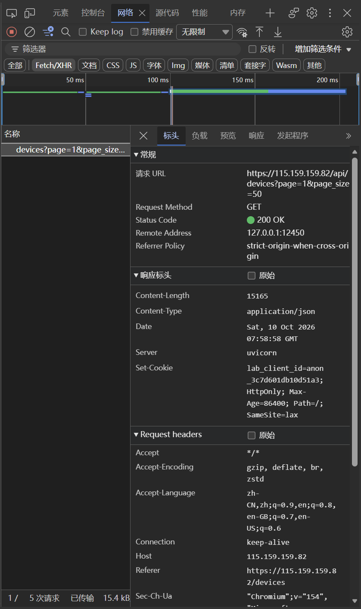
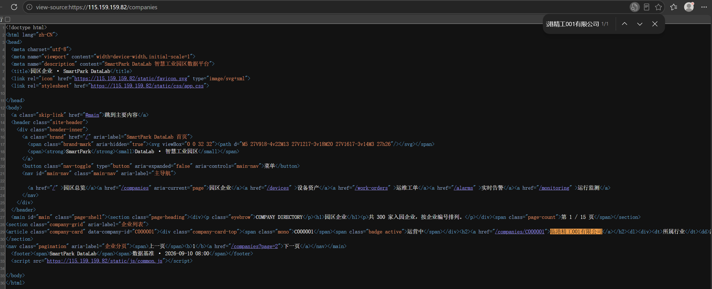
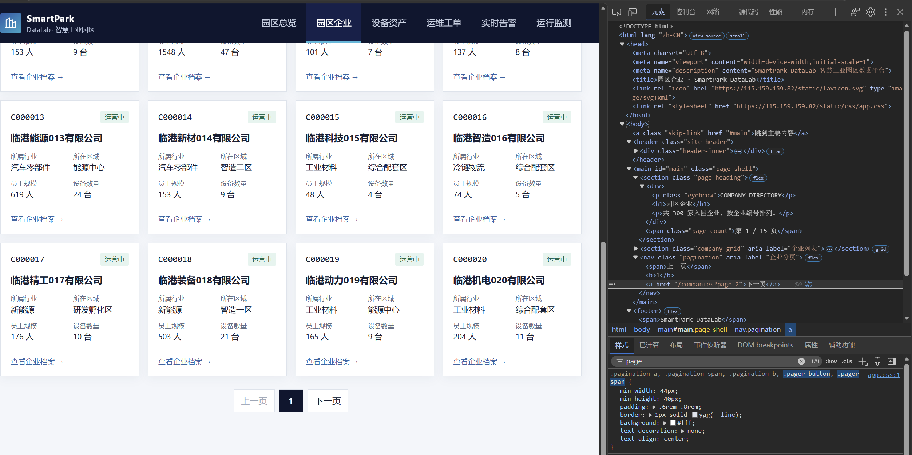
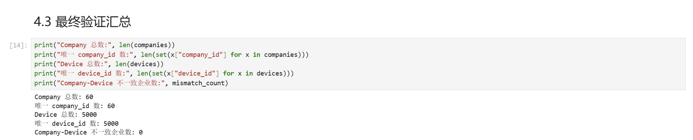

# Lab 1 实验报告

## 学生信息

- **姓名：** 陆禹贺垚
- **学号：** 112404260118
- **班级：** 数据1241
- **GitHub 用户名：** luyuheyao
- **仓库地址：** https://github.com/luyuheyao/shujucaiji

> 文件位置：`lab01/REPORT.md`  
> 完整代码保存在 `lab1_html_api.ipynb`。  
> 本报告只填写关键发现、关键代码、结果和指定截图，**不要把整份 Notebook 复制进来**。

---

# 任务 1：判断数据加载方式

## 1.1 Device：判断动态加载并找到 API

### 判断结果

- 页面：`/devices`
- 数据加载方式：`动态加载`
- 判断依据：

在“查看网页源代码”中搜索页面上显示的设备名称（如“循环泵-000001-001”）找不到，源代码中只有“正在加载…”的占位行；打开 F12 → Network → Fetch/XHR 刷新页面后，可以找到返回设备列表 JSON 的 `/api/devices` 请求，因此判定为动态加载。

### API 信息

- Request URL：`https://115.159.159.82/api/devices`
- Request Method：`GET`
- Query 参数：`page`（当前页）、`page_size`（每页条数）

### 【截图 1】Device API 发现证据

文件名：

```text
images/01_device_api.png
```

```markdown

```

---

## 1.2 Company：判断静态加载

- 页面：`/companies`
- 数据加载方式：`静态加载`
- 判断依据：

使用“右键 → 查看网页源代码”后，按 Ctrl+F 搜索页面中真实显示的企业名称（如“临港精工001有限公司”），可以在源代码中直接找到该企业名称及对应的 `<article class="company-card">` 记录，说明企业数据随初始 HTML 一起返回，属于静态加载。

### 【截图 2】Company 静态加载证据

文件名：

```text
images/02_company_source.png
```

```markdown

```

---

# 任务 2：Device API 分页采集

## 2.1 API 分页结构

| 含义 | JSON 字段 |
|---|---|
| 当前页 | `page` |
| 每页条数 | `page_size` |
| 设备总数 | `total` |
| 设备列表 | `items` |

---

## 2.2 关键代码

```python
# 从第一页响应中读取分页信息
total = data["total"]
page_size = data["page_size"]

total_pages = (total + page_size - 1) // page_size

devices = []

for page in range(1, total_pages + 1):
    r = requests.get(
        api_url,
        params={
            "page": page,
            "page_size": page_size
        },
        timeout=10,
        verify=False
    )

    page_data = r.json()
    page_items = page_data["items"]
    devices.extend(page_items)
```

---

## 2.3 采集结果

- 每页条数：50
- 设备总数：5000
- 程序计算得到的总页数：100
- 最终采集设备数：5000
- 唯一 `device_id` 数：5000

回答：

> 为什么总页数应由 API 返回的 `total` 和 `page_size` 计算，而不是直接在代码里写死？

答：因为数据总量和分页规则是服务端决定的，可能随时间变化。写死页数在数据增加时会漏采、减少时会请求不存在的页面导致报错或脏数据；用 `total` 和 `page_size` 实时计算能保证任何数据规模下都恰好采完整，不多也不少。

---

# 任务 3：Company HTML 解析

## 3.1 企业记录 Selector

- 企业记录 selector：`article.company-card`
- 第 1 页企业记录数：20

说明为什么选择这个 selector：

答：主要使用了 `class`。每条企业记录的最外层节点是 `<article class="company-card">`，`company-card` 这个 class 语义明确、在列表中唯一对应企业卡片，且不依赖 `nth-child` 等位置关系，对页面结构变化不敏感。参考过浏览器 Copy selector，但自动生成的路径含大量层级和序号，过长且脆弱，因此最终采用 `article.company-card` 这个短写法，并在代码中验证第 1 页恰好选出 20 条。

---

## 3.2 关键代码

```python
cards = soup.select("article.company-card")

card = cards[0]

company_id = card.get("data-company-id")
name = card.select_one("h2 a").get_text(strip=True)
status = card.select_one(".company-card-top .badge").get_text(strip=True)
```

行业、区域、设备数量使用 `dt/dd` 结构后，请写出你最终如何得到：

```python
industry = details["所属行业"]
zone = details["所在区域"]
device_count = int(re.sub(r"[^0-9]", "", details["设备数量"]))
```

（`details` 由 `for item in card.select("dl > div")` 循环读取 `dt/dd` 文本构成的字典）

---

## 3.3 字段来源说明

1. 字段：`company_id`
   - 来自：`HTML 属性`
   - 使用的方法：读取企业卡片节点的 `data-company-id` 属性，即 `card.get("data-company-id")`

2. 字段：`device_count`
   - 来自：`文本`
   - 使用的方法：从 `dt/dd` 字典中取 `details["设备数量"]`（形如“6 台”），用正则去掉非数字字符后 `int()` 转成整数

---

# 任务 4：Company “下一页”分页

## 4.1 下一页元素

- “下一页” selector：`nav.pagination a`（在结果中按文本“下一页”过滤）
- 第 1 页 `href` 示例：`/companies?page=2`

### 【截图 3】Company “下一页”元素

文件名：

```text
images/03_company_next.png
```

```markdown

```

---

## 4.2 关键代码

```python
next_link = None
for a in soup.select("nav.pagination a"):
    if a.get_text(strip=True) == "下一页":
        next_link = a
        break

next_href = next_link.get("href")

next_url = urljoin(
    current_url,
    next_href
)
```

再用 2～3 句话说明：

> 你的程序如何完成“当前页 → 找下一页 href → 请求下一页 → 再解析”的循环？

答：循环体内先用 `requests.get(current_url)` 请求当前页，用 BeautifulSoup 解析出本页 20 条企业记录加入总列表；然后在 `nav.pagination` 的 `<a>` 标签中找文本为“下一页”的链接，用 `urljoin` 把相对 href 拼成完整 URL 赋给 `current_url`，进入下一轮；如此重复 3 次即采集 3 页。中间页“上一页”也是 `<a>`，所以必须按文本过滤，否则会取错链接回到上一页。

---

## 4.3 三页采集结果

| 页码 | 企业数 |
|---|---:|
| 1 | 20 |
| 2 | 20 |
| 3 | 20 |
| **合计** | 60 |

- 唯一 `company_id` 数：60

---

# 任务 5：结果验证

## 5.1 最终结果

| 检查项 | 结果 |
|---|---:|
| Company 总数 | 60 |
| 唯一 `company_id` | 60 |
| Device 总数 | 5000 |
| 唯一 `device_id` | 5000 |
| Company–Device 不一致企业数 | 0 |

### 【截图 4】最终验证结果

文件名：

```text
images/04_validation.png
```

```markdown

```

---

## 5.2 一致性检查关键代码

```python
from collections import Counter

device_counts = Counter(
    x["company_id"] for x in devices
)

mismatch_count = 0

for company in companies:
    cid = company["company_id"]
    expected = company["device_count"]
    actual = device_counts.get(cid, 0)

    if expected != actual:
        mismatch_count += 1
```

回答：

> 为什么 `status_code == 200` 仍然不能说明“数据已经采集正确”？

答：200 只表示 HTTP 请求成功返回了响应，不代表响应内容符合预期。分页参数写错、翻页漏页或重复、字段提取错位时，服务器照样返回 200。所以还要做内容级验证：核对采集总数与 `total`、检查 ID 唯一性、做 Company–Device 跨数据源一致性比对，全部通过才能说明数据采对了。

---

# 任务 6：保存采集结果

确认已经生成：

```text
data/companies.json
data/devices.json
```

填写：

- `companies.json`：`已生成`
- `devices.json`：`已生成`

---

# 实验结论

答：静态页面的数据随 HTML 一起返回，可直接 requests 请求后用 BeautifulSoup 解析；动态页面数据由 JS 调 API 加载，需在 Network 中找到真实 API 直接采 JSON。HTML 分页靠解析“下一页”链接逐个跟进，API 分页则按 total/page_size 计算总页数后循环传 page 参数。验证时检查了采集数量、ID 唯一性，并用 Counter 做了 Company 页面 device_count 与 Device 实际数量的跨源一致性比对。
