# 实验二报告：房源采集与 MySQL 存储

- 班级：数据1241
- 姓名：陆禹贺垚
- 学号：112404260118
- 实验日期：2026-10-27
- GitHub 仓库链接：<https://github.com/luyuheyao/shujucaiji>
- 源码文件名：`anjuke.ipynb`
- 数据库与表：`smartpark_lab.houseinfo`
- 数据来源：在线教学站 <http://www.bspider.top/anjuke/>
- 访问时间及结果（若失败，填写状态码、页面标题或报错）：2026-10-27 14:30—14:32，HTTP 200，网页标题「重庆二手房房产网，重庆二手房出售，重庆买房购房交易信息 - 58安居客」，每页 60 条房源，共 10 页
- 快照文件来源与文件名（在线实验可写“不适用”）：不适用（在线采集成功，未使用快照）

## 第一阶段：MySQL Docker 更新与启动

- 本次是否需要更新：本次按更新包说明更新。用增量包里的 `mysql-8.4.11-amd64.tar` 导入镜像，导入后镜像 ID 为 `sha256:85b9bf2e29cf836ecb8c2a15a935d4ba0c606631dff1dd79531a11983c638f2a`，与增量包说明中的预期值一致。
- 更新或启动遇到的问题：Docker Desktop 启动后引擎正常（`linux/x86_64`）；导入镜像后启动课程 MySQL 容器，健康检查通过，`SHOW DATABASES` 能看到 `smartpark_lab`。旧数据卷保留，没有删卷或重置密码。

### 启动环境与建表

依次使用 `start-course.bat`、`start-mysql.bat`、`mysql-console.bat` 启动课程环境、数据库和 MySQL 终端；在 `Enter password:` 处输入课程教学密码后进入 `mysql>`。

建表语句（在 MySQL 终端执行）：

```sql
USE smartpark_lab;
CREATE TABLE IF NOT EXISTS houseinfo (
    id INT AUTO_INCREMENT PRIMARY KEY COMMENT '自增长主键',
    title VARCHAR(200) COMMENT '标题',
    house VARCHAR(50) COMMENT '楼盘',
    address VARCHAR(200) COMMENT '地址',
    struct VARCHAR(50) COMMENT '户型',
    area VARCHAR(20) COMMENT '建筑面积',
    floor VARCHAR(20) COMMENT '楼层',
    maketime VARCHAR(20) COMMENT '建造年代',
    price VARCHAR(20) COMMENT '每平方米单价'
) CHARACTER SET utf8mb4;
```

执行 `DESCRIBE houseinfo;` 后确认 9 个字段（`id` + 8 个房源字段）类型与注释正确；建表后 `SELECT COUNT(*) AS before_count FROM houseinfo;` 结果为 **0**。

**截图：** MySQL 启动成功提示，以及终端中 `USE smartpark_lab`、`SHOW TABLES`、`DESCRIBE houseinfo` 的执行结果。

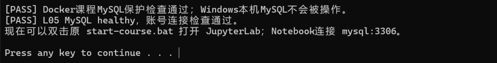

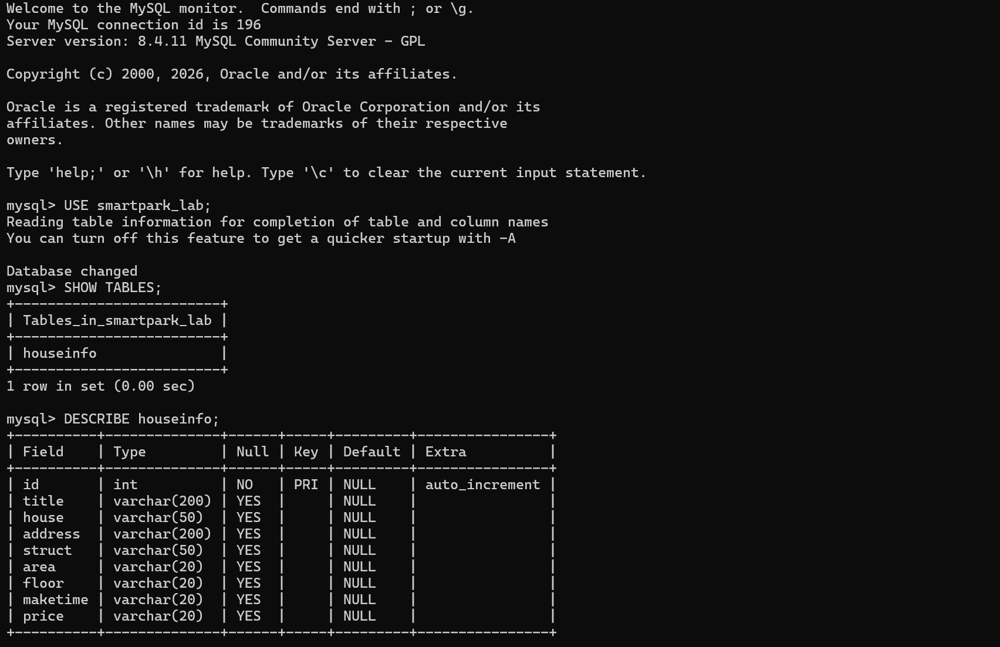

说明：当前使用哪个数据库？`id` 和8个房源字段分别保存什么？

答：当前使用 `smartpark_lab` 数据库中的 `houseinfo` 表。`id` 是 MySQL 自动递增生成的主键，只用于标识行，不是房源编号；其余 8 列依次保存：`title` 房源卖点标题、`house` 楼盘名、`address` 地址（页面里由多个 `<span>` 拼接而成）、`struct` 户型（如 `3室2厅1卫`）、`area` 建筑面积（保留 `㎡`）、`floor` 楼层（如 `低层(共27层)`）、`maketime` 建造年代（如 `2019年建造`，缺失时存空字符串）、`price` 每平方米单价（`元/㎡`，不是总价）。

## 第二阶段：房源采集与 CSV 数据存储

### 1. 网页分析与房源解析

#### 选择器是怎样得到的

在 Chrome 中按 F12，使用 **Elements → Copy → Copy selector**。选一个字段，记录从完整路径到相对选择器的过程。

- 选择的字段：标题 `title`
- 复制的原始选择器：浏览器复制出来是一条从页面根部按位置定位的长路径，形如

  ```text
  body > div > div > section > section > section.list > div:nth-child(1)
       > a > div.property-content > div.property-content-detail
       > div.property-content-title > h3
  ```

  路径里包含多层 `div:nth-child(k)`，位置一变就会失效。
- 一条房源的父容器选择器：`div.property`（卡片最外层 `div`，class 为 `property`）
- 最终使用的相对选择器：先 `soup.select("div.property")` 取出全部卡片，再在卡片内部用相对选择器取字段：

  | 字段 | 相对选择器 |
  |---|---|
  | title | `h3` |
  | house | `.property-content-info-comm-name` |
  | address | `.property-content-info-comm-address` |
  | struct | `p.property-content-info-attribute` |
  | area / floor / maketime | `p.property-content-info-text`（属性组，按文字特征区分） |
  | price | `.property-price-average` |

**截图：** 框出该字段的 HTML 节点和房源父容器，展示选择器的匹配结果。

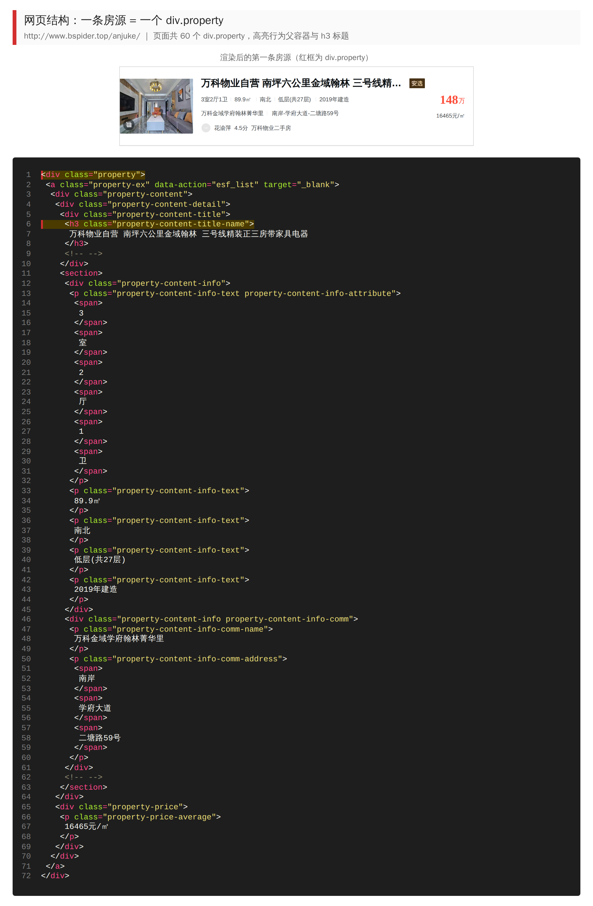

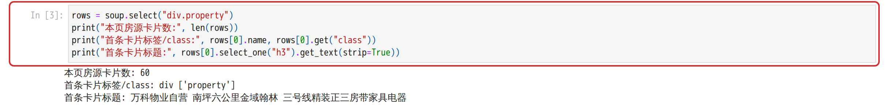

说明：删掉了哪些层级？怎样确认父容器刚好包含一条房源？

答：删掉了从 `body` 到 `section.list` 之间的全部层级和所有 `nth-child` 位置限制，只保留语义明确的 `div.property`；字段则从「整页路径」改成「卡片内部相对选择器」，例如标题只写 `h3`。确认方法是：`select("div.property")` 返回 **60** 个节点，与页面 60 条房源一一对应；再看一条卡片内部，能同时找到标题 `h3`、楼盘 `.property-content-info-comm-name`、地址 `.property-content-info-comm-address`、属性组和单价，说明它刚好包住一条房源；第二张卡片的 class 与第一张相同，因此可以批量处理。

#### 解析8个字段

**截图：** 自己编写的解析代码和首条房源的8个字段输出。代码中必须框出：

- `select()` 和 `select_one()`。
- 面积、单价的定位与取值。
- 建造年代的提取和缺失处理。

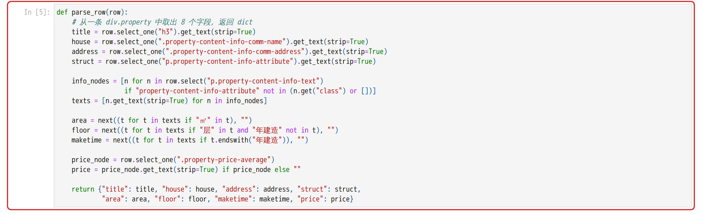

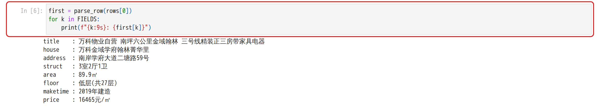

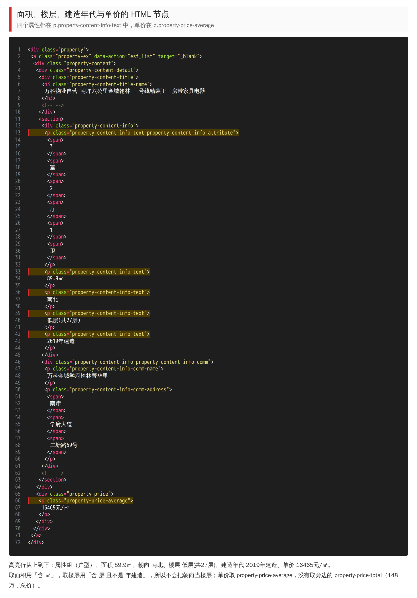

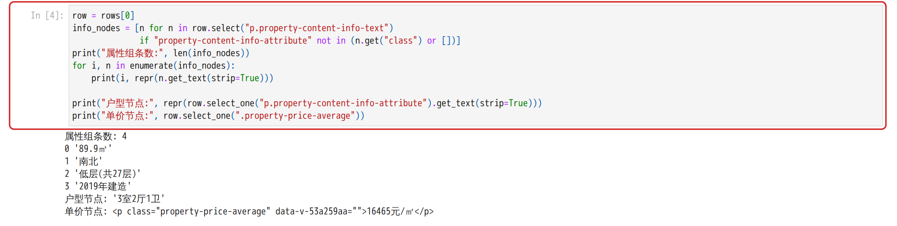

说明：两个选择方法各用在哪里？怎样确认面积和单价没有取错？

答：`select()` 用来取「列表」——`soup.select("div.property")` 取全部房源，`row.select("p.property-content-info-text")` 取一条房源的属性组；`select_one()` 用来取「单个节点」——`row.select_one("h3")`、`.property-content-info-comm-name`、`.property-content-info-comm-address`、`p.property-content-info-attribute`、`.property-price-average`。

确认面积和单价的方法：先打印首条房源的属性组，输出为 `89.9㎡ / 南北 / 低层(共27层) / 2019年建造`，确认第 0 项是面积、第 1 项是朝向、第 2 项是楼层，不能按下标把朝向当楼层；代码里再用文字特征区分——面积取「含 `㎡`」的一项，楼层取「含 `层` 且不是 `年建造`」的一项，建造年代取「以 `年建造` 结尾」的一项，顺序变化也不会取错。单价取 `.property-price-average`，首条为 `16465元/㎡`，与页面单价一致；页面上的 `148万` 在 `.property-price-total` 中，是总价，没有取。

### 2. 下一页采集

- 下一页 `href` 原值：`?page=2`
- 用 `urljoin()` 补全后的地址：`http://www.bspider.top/anjuke/?page=2`
- 实际停止原因（明确禁用的末页按钮 / 异常中止）：第 10 页的「下一页」按钮 class 只剩 `next`（失去 `next-active`），`href` 为 `#`，判定到达末页，**正常结束**，不是异常中止

**截图：** 框出提取 `href`、补全地址、循环更新地址和停止条件的代码。附前两页的运行日志，以及最终停止提示。

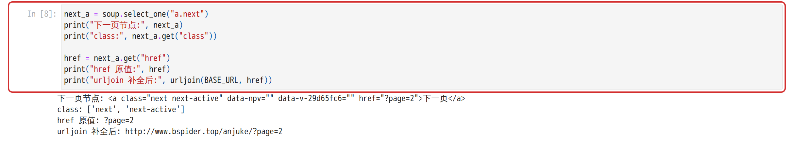

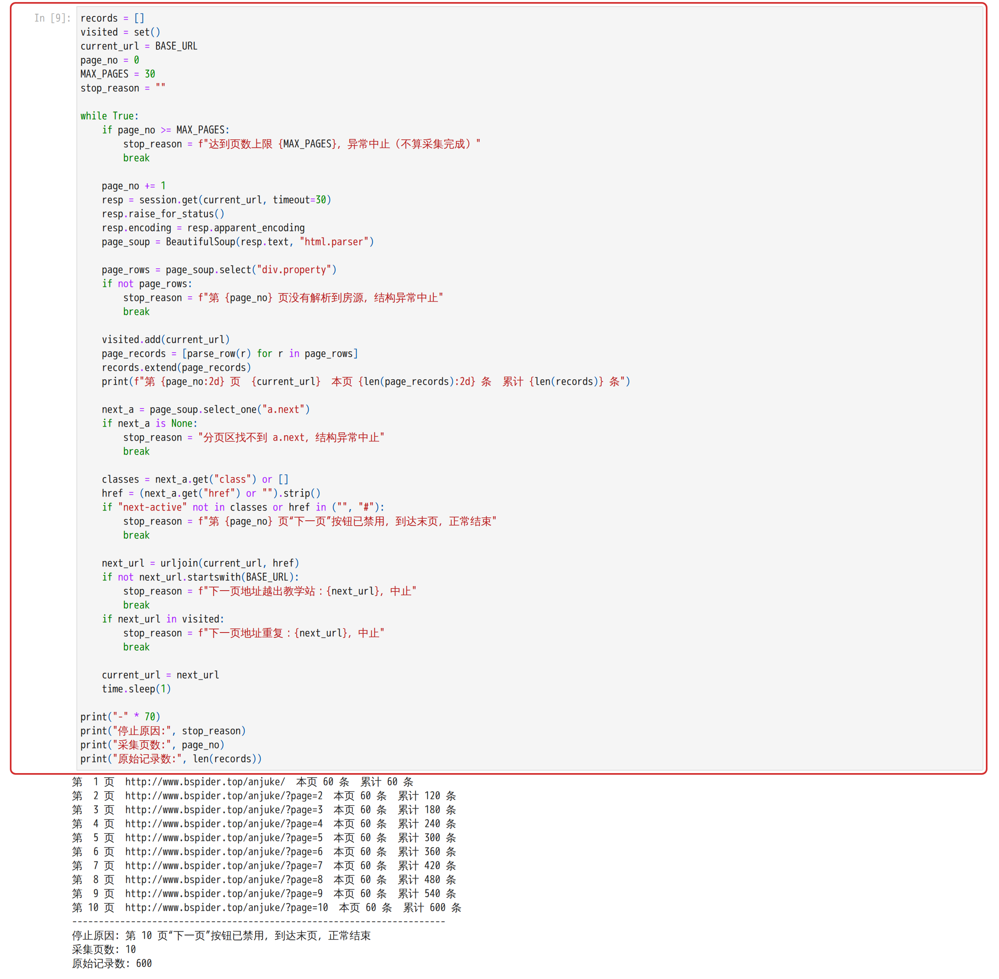

说明：怎样进入下一页？怎样防止重复采集或无限循环？若中途失败，说明停在哪一步。

答：每页解析完用 `page_soup.select_one("a.next")` 找按钮，`get("href")` 读相对地址，再用 `next_url = urljoin(current_url, href)` 补成完整地址，把 `current_url` 换成它进入下一轮。防止重复和死循环有四个措施：① `visited` 集合记录已访问地址，新地址已在集合中就中止；② 判断新地址必须以 `BASE_URL` 开头，防止跳出教学站；③ 设置 `MAX_PAGES = 30` 安全上限，达到上限只记为中止；④ 每页之间 `time.sleep(1)`，降低请求频率。末页的判断是「按钮存在但 `next-active` 消失或 `href` 为 `#`」，只有这一种情况才算正常采完。本次没有中途失败，10 页全部采完。

### 3. 保存 CSV

**截图：** CSV保存与回读代码、回读条数。框出编码、表头和数据写入部分。

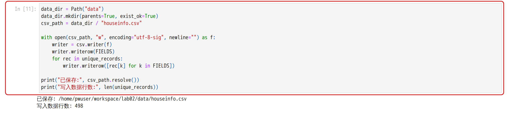

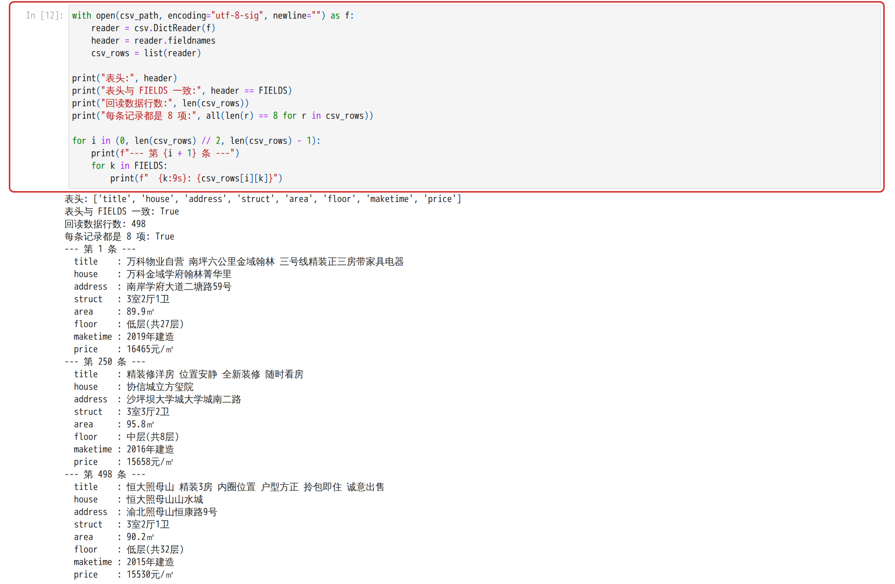

说明：8个字段的顺序是什么？按8个字段完全相同去重后，保存了多少条记录？

答：顺序为 `title → house → address → struct → area → floor → maketime → price`，解析、写 CSV、入库三处共用同一个 `FIELDS` 列表。采集到 10 页共 **600** 条原始记录，按 8 个字段完全相同去重后删除 **102** 条重复记录，`data/houseinfo.csv` 保存 **498** 条数据（不含表头）。文件用 `utf-8-sig` 编码、`newline=""`、`csv.writer` 写入；用 `csv.DictReader` 回读，表头与 `FIELDS` 一致，数据行数为 498，每条恰好 8 项。

## 第三阶段：MySQL 数据存储

### 1. 读取 CSV 并入库

本阶段读取第二阶段的 `data/houseinfo.csv`，不重新采集。

**截图：** 框出读取CSV、按8个字段整理入库参数的代码。

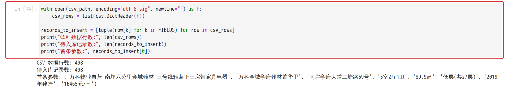

**截图：** 自己编写的入库代码。框出 `executemany()`、`commit()`、`rollback()`，以及关闭游标和连接的操作。另框出避免重复插入的代码。

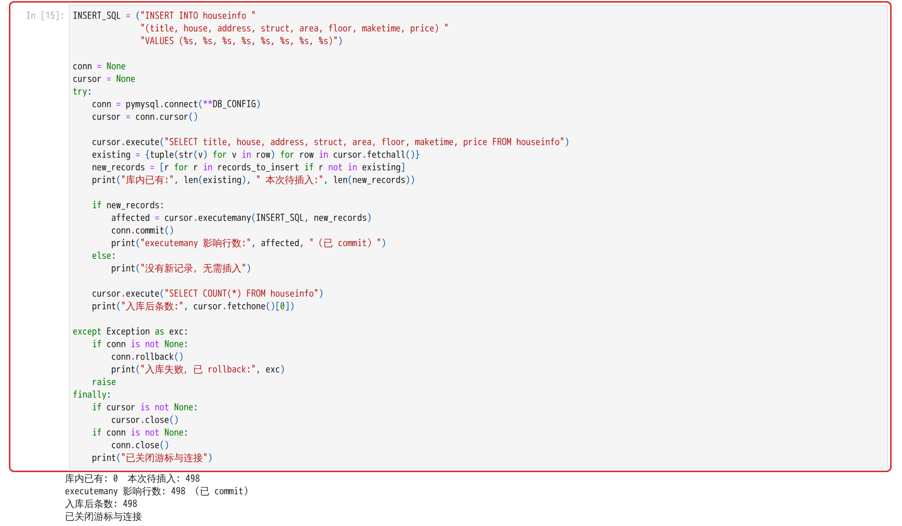

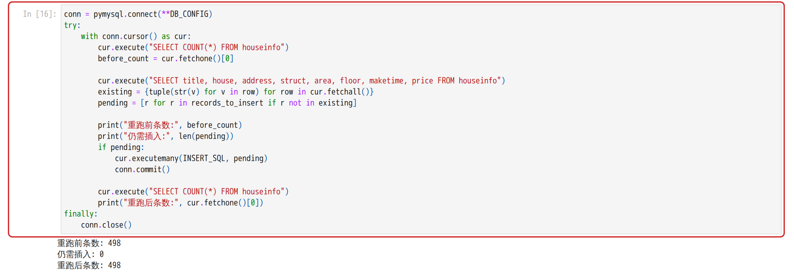

说明：每条记录怎样对应8个参数？成功、失败时分别做什么？再次运行时怎样避免重复插入？

答：CSV 每一行按 `FIELDS` 顺序取 8 个值组成元组，`records_to_insert` 中每个元组就是 8 个值；INSERT 语句里 8 个字段与 8 个 `%s` 一一对应，`executemany(INSERT_SQL, records)` 把每个元组的 8 个值依次填进 8 个占位符，不做字符串拼接。成功时 `conn.commit()` 提交事务；出现异常时先 `conn.rollback()` 撤销本次未提交的修改，再把异常抛出；无论成功失败，`finally` 中先 `cursor.close()` 再 `conn.close()`。再次运行时不用自增 `id` 判重，而是先 `SELECT` 出库内已有的 8 字段组合放进集合，只插入不在集合中的记录，所以本批数据重跑时「仍需插入 0 条」，条数保持 498。

### 2. 核对结果

#### 查询条数和样本

**截图：** MySQL 终端中的入库前后 `SELECT COUNT(*)`、重跑后的条数，以及 `SELECT ... LIMIT 5` 的结果。

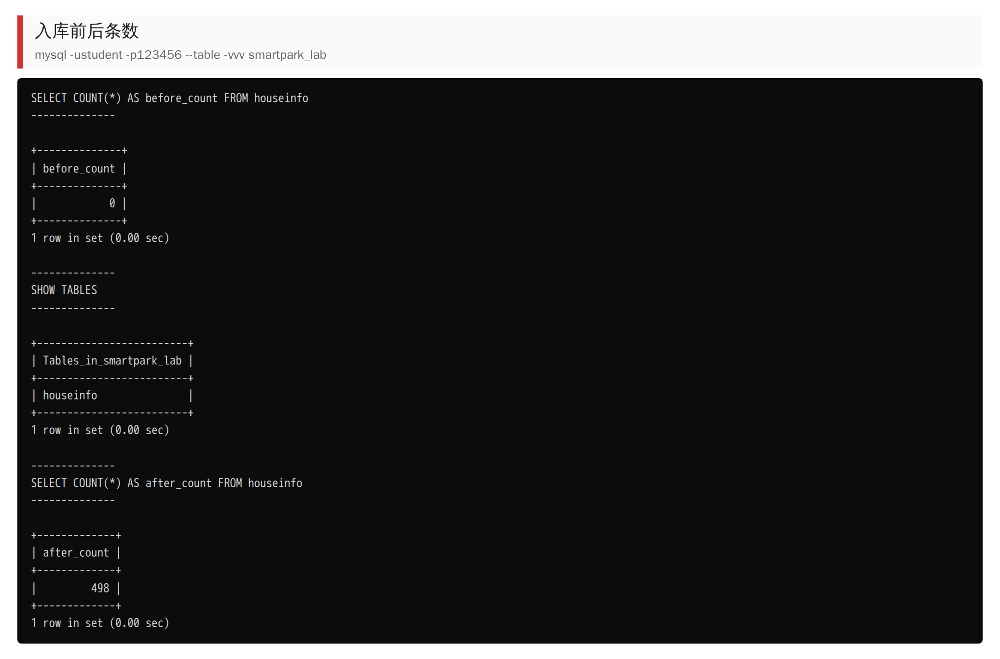

| 项目 | 实际结果 |
|---|---|
| 成功采集页数 | 10 |
| 采集记录数（去重前） | 600 |
| 完全相同的重复记录数 | 102 |
| CSV数据行数（不含表头） | 498 |
| 入库前条数 | 0 |
| 入库后条数 / 本次新增条数 | 498 / 498 |
| 关闭上次程序后，同批数据独立重跑的条数 / 新增条数 | 498 / 0 |
| 是否采集完整；未完成的原因 | 采集完整：第 10 页「下一页」按钮已禁用，正常结束；无未完成项 |

说明：首次入库后的条数应等于去重后的CSV数据行数，8个字段的内容也应一致。若不一致，说明原因。总条数以实际结果为准。

答：首次入库后 `SELECT COUNT(*)` 为 **498**，与去重后的 CSV 数据行数 **498** 完全相等；库内 `MIN(id)=1`、`MAX(id)=498`，没有断号，说明批量插入一次成功。用 `COUNT(DISTINCT title, house, address, struct, area, floor, maketime, price)` 统计也是 498，说明库内没有 8 字段完全相同的重复行。`executemany()` 返回的影响行数也是 498，与新增条数一致。

#### 逐条核对

选取第一条、跨页一条和最后一条，比较网页、CSV与数据库中的8个字段。

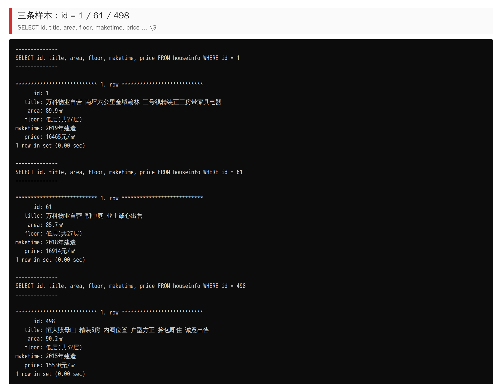

- 样本1（页码或URL、记录位置）：第 1 页第 1 个卡片，CSV 第 1 行，数据库 `id=1`
- 样本2（页码或URL、记录位置）：第 2 页第 1 个卡片（跨页样本，`http://www.bspider.top/anjuke/?page=2`），CSV 第 61 行，数据库 `id=61`
- 样本3（页码或URL、记录位置）：第 10 页第 60 个卡片（最后一条），CSV 第 498 行，数据库 `id=498`

| 字段 | 样本1 | 样本2 | 样本3 |
|---|---|---|---|
| title | 万科物业自营 南坪六公里金域翰林 三号线精装正三房带家具电器 | 万科物业自营 朝中庭 业主诚心出售 | 恒大照母山 精装3房 内圈位置 户型方正 拎包即住 诚意出售 |
| house | 万科金域学府翰林菁华里 | 万科金域学府翰林菁华里 | 恒大照母山山水城 |
| address | 南岸学府大道二塘路59号 | 南岸学府大道二塘路59号 | 渝北照母山恒康路9号 |
| struct | 3室2厅1卫 | 3室2厅1卫 | 3室2厅1卫 |
| area | 89.9㎡ | 85.7㎡ | 90.2㎡ |
| floor | 低层(共27层) | 低层(共27层) | 低层(共32层) |
| maketime | 2019年建造 | 2018年建造 | 2015年建造 |
| price | 16465元/㎡ | 16914元/㎡ | 15530元/㎡ |

核对结论及差异：三条样本的 8 个字段在网页、CSV、数据库三处完全一致，没有差异。重点检查的两项：面积都带 `㎡` 单位且数值与页面一致；单价都是 `元/㎡` 的每平方米价格，没有误取成 `148万` 这类总价；建造年代都是「年份 + 年建造」的完整文字，本次 600 条记录中没有出现年代缺失（缺失时按设计填空字符串）。

## 问题与解决

- 遇到的问题、处理方法及结果（没有可写“无”）：

  1. 2026-10-26 教学站返回过访问验证页。10-27 重新访问时恢复正常（状态码 200、标题为房源列表、每页 60 条），因此按在线方式采集，没有改用快照。
  2. 第 8—10 页与前面页面重复较多（第 9 页只贡献 2 条新记录），原始 600 条里有 102 条 8 字段完全相同。按实验要求用 8 字段去重后写入 CSV（498 条），并在报告中如实记录去重前后条数，没有为了凑数保留重复行。
  3. 课程 MySQL 镜像需要先用增量包的 tar 文件 `docker load` 导入，导入后核对了镜像 ID 与说明一致，再启动容器。
- 尚未解决的问题、未完成的步骤（没有可写“无”）：无。

## 思考题

1. 本次怎样实现下一页采集？结合自己的代码说明。

   答：先定位按钮 `page_soup.select_one("a.next")`，它的 `href` 只有 `?page=2` 这样的相对地址，所以用 `next_url = urljoin(current_url, href)` 以当前页地址为基准补全，再把 `current_url` 指向它进入下一轮；循环里用 `visited` 记录已访问地址防止重复、用 `MAX_PAGES` 防止死循环、用 `startswith(BASE_URL)` 防止越出教学站，`time.sleep(1)` 控制请求间隔。停止条件是第 10 页按钮 class 变成只有 `next`、`href` 变成 `#`，说明「下一页」已禁用，此时记为正常采完末页；如果按钮整个消失或找不到，则记为结构异常，不能算完成。

2. 旧代码把 out_list 定义在全局。你把结果列表放在哪里？为什么？

   答：没有用全局变量，结果列表 `records` 和去重后的 `unique_records` 都定义在采集单元内部，跟着当前单元的执行过程产生，再用函数 `parse_row(row)` 把「一条卡片 → 一个字典」的逻辑封装起来，函数不依赖任何全局状态。好处是：重复执行单元时不会在旧列表上继续追加导致条数翻倍；多个单元之间不会互相污染；`parse_row` 可以拿单条卡片单独测试；分页循环里每页的 `page_records` 是局部变量，便于逐页核对条数。

3. 你怎样获取建造年代？节点缺失或顺序改变时，怎样处理？

   答：建造年代是属性组 `p.property-content-info-text` 中的一项，我没有写死下标，而是先取出属性组全部文字，再用 `next((t for t in texts if t.endswith("年建造")), "")` 按「以 `年建造` 结尾」这个特征去找，找到就取整段文字（如 `2019年建造`），找不到就返回空字符串，CSV 里就写空字符串，不会报错也不会错位。同理面积按「含 `㎡`」、楼层按「含 `层` 且不是 `年建造`」来定位，所以即使属性组里少了一项或顺序变了，也不会把朝向或年代当成楼层。本次 600 条记录中建造年代全部存在，`maketime` 空值统计为 0。

## 提交检查

- [ ] 实验一原仓库的 `lab02/` 中已有源码、CSV、报告和真实截图。
- [ ] 截图清楚，关键代码已框出，每项附有个人解释。
- [ ] GitHub上能打开文件和图片，未上传个人账号密码、`.env`或教师答案。
- [ ] 未完成项已如实说明；学习通只交原仓库链接。

如使用 AI，简述它帮助了什么，以及自己修改、运行和核对了什么：

答：使用 AI 助手辅助编写了采集、解析、翻页、CSV 保存和批量入库的代码框架，以及本报告的初稿；本人完成课程环境的启动与数据库建表、在 JupyterLab 中运行 Notebook、按网页逐字段核对解析结果，并对 CSV 与数据库中的 3 条样本做了三方对照和截图。
